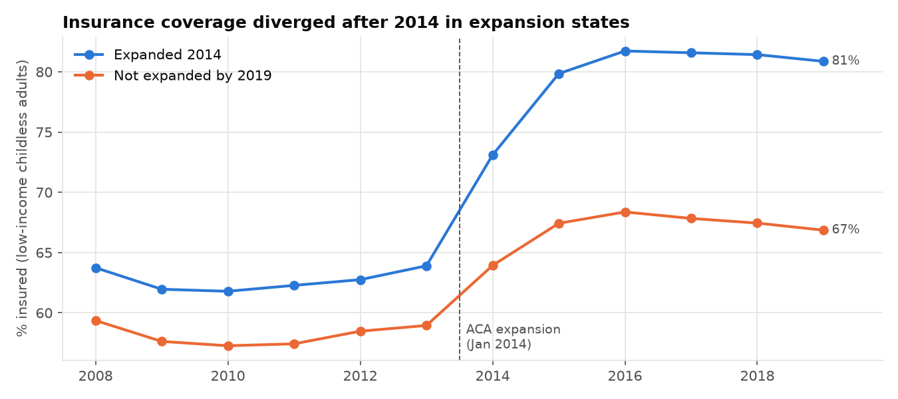
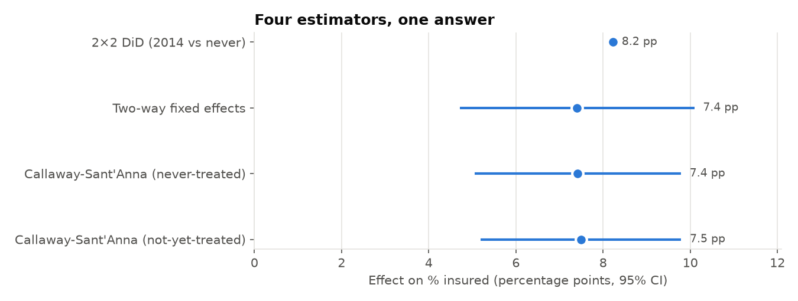
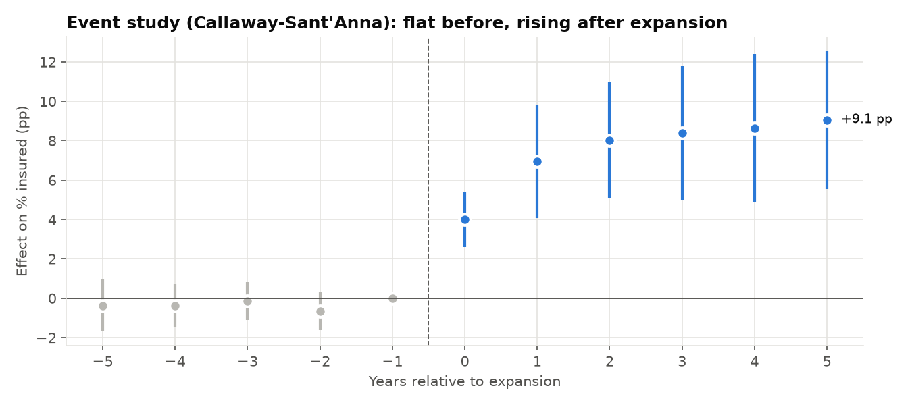
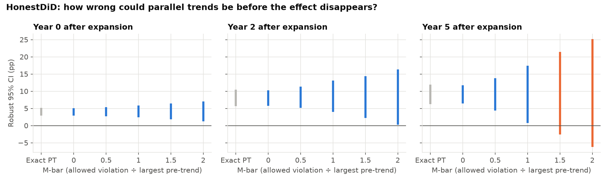
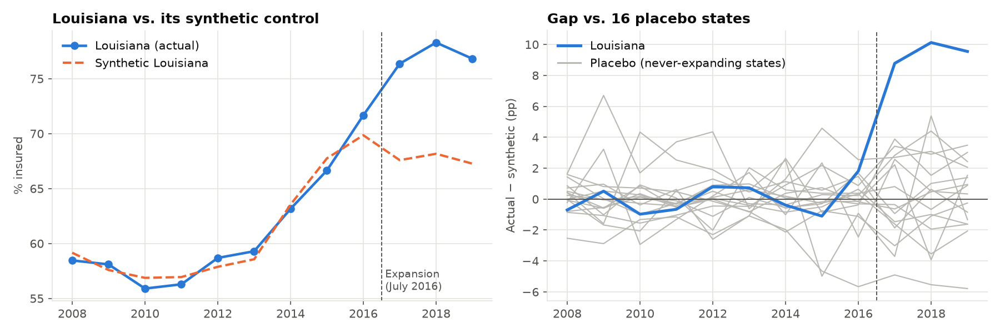

# Did Medicaid Expansion Work? A Causal Inference Study

Under the Affordable Care Act, states could expand Medicaid to low-income adults starting in 2014. Some did right away, some years later, and some never did. That staggered rollout is a natural experiment.

**Question:** how much did expansion raise health insurance coverage among low-income adults without children, the group it was designed for?

**Answer:** **+7.4 percentage points** (95% CI: 5.1 to 9.8). The effect started at +4.0 points in the first year and grew to +9.1 by year five. Four different estimators, a sensitivity analysis and a single-state synthetic control all point to the same conclusion.



## Why this needs more than a before/after comparison

Coverage rose in *every* state after 2014: non-expansion states also got ACA marketplaces and subsidies. A simple before/after comparison would credit Medicaid with gains that had other causes. **Difference-in-differences** subtracts the change in non-expansion states:

| | Before (2008–13) | After (2014–19) | Change |
|---|---|---|---|
| States that expanded in 2014 | 62.7% | 79.8% | **+17.0 pp** |
| States not expanded by 2019 | 58.2% | 67.0% | **+8.8 pp** |
| **Difference-in-differences** | | | **+8.2 pp** |

Half of the raw gain in expansion states would have happened anyway. The other half is the expansion effect.

## Methods and results

States expanded in different years (2014, 2015, 2016, 2017, 2019), and the effect grows over time. That combination is exactly where the traditional **two-way fixed effects (TWFE)** regression can give biased answers, because it ends up using already-treated states as controls. So this project compares TWFE with the modern **Callaway & Sant'Anna (2021)** estimator, which only compares each expansion cohort with valid controls.



| Method | Estimate | 95% CI |
|---|---|---|
| 2×2 DiD (2014 expanders vs. never) | 8.2 pp | — |
| Two-way fixed effects (state-clustered SEs) | 7.4 pp | 4.7 – 10.1 |
| Callaway–Sant'Anna, never-treated controls | **7.4 pp** | **5.1 – 9.8** |
| Callaway–Sant'Anna, not-yet-treated controls | 7.5 pp | 5.2 – 9.8 |

In this dataset TWFE happens to land close to the robust estimators. That's worth knowing, but you only know it by checking.

### Event study: testing parallel trends

DiD assumes expansion and non-expansion states would have followed **parallel trends** without the policy. The event study checks the years *before* expansion. All five pre-period estimates are within 0.7 points of zero, then the effect jumps at expansion and keeps growing as enrollment ramps up.



### HonestDiD: what if parallel trends isn't exactly true?

Flat pre-trends don't prove the assumption. Following **Rambachan & Roth (2023)**, I let the post-expansion trend difference be up to *M̄* times the largest pre-expansion deviation and recomputed robust confidence intervals.



- **Year 0 and year 2 effects stay significant at M̄ = 2**, the largest value tested. Trend violations would have to be more than **twice as large** as anything seen before 2014 to erase them.
- **The year 5 effect holds up to M̄ = 1** and becomes inconclusive beyond that (orange bars). Long-run estimates are naturally less certain.

### Synthetic control: Louisiana as a single-state case study

Louisiana expanded in July 2016, so 2017 was its first full year. I built a **synthetic Louisiana**, a weighted blend of never-expanding states chosen to match Louisiana's coverage from 2008–2016: Georgia 37%, South Carolina 28%, Florida 19%, Tennessee 9%, Kansas 8%. The synthetic version tracks the real one closely before expansion (RMSE 0.9 pp), then the two split apart.



- Louisiana's coverage ran **9.5 pp above** its synthetic control in 2017–2019, close to the national 2-year+ event-study effects of 8–9 pp.
- **Placebo test:** rerunning the method with each of the 16 never-expanding states as if *it* had been treated, Louisiana's post/pre error ratio ranks **1st of 17**. That's the most extreme outcome possible with this donor pool (permutation p = 1/17 ≈ 0.06).
- The gap starts opening in 2016, consistent with expansion taking effect mid-year.

## Data

- **Source:** American Community Survey (ACS) estimates of the share of low-income (≤ 138% of the federal poverty level) childless adults aged 19–64 with health insurance. These are state-level, 2008–2019, weighted by state population. They're distributed with the [`moderndid`](https://github.com/jordandeklerk/moderndid) package (`load_ehec`) and are the same data used in *Baker, Callaway, Cunningham, Goodman-Bacon & Sant'Anna, "Difference-in-Differences Designs: A Practitioner's Guide."* A copy is in [`data/`](data/).
- **46 states.** Delaware, DC, Massachusetts, New York and Vermont are excluded because they already covered this group before 2014, so they're neither clean treatment nor clean control units.
- **Expansion timing:** 2014 (22 states), 2015 (IN, NH, PA), 2016 (AK, MT), 2017 (LA), 2019 (ME, VA). 16 states had not expanded by 2019. Timing follows the source data; Wisconsin is coded as 2014 because it extended BadgerCare to childless adults that year without adopting the ACA expansion.

## Limitations

- State-level averages can't show *who* gained coverage within a state. Individual-level ACS microdata would allow that.
- Coverage is the first link in the chain. Effects on health, mortality or medical debt need other data.
- With 16 donor states, the synthetic-control p-value can't go below 1/17.

## Run it

```bash
pip install -r requirements.txt
python run_analysis.py     # all estimators, charts → images/, tables → results/
pytest                     # 5 tests, incl. recovering known effects from simulated data
```

## Project structure

```
├── src/
│   ├── analysis.py   # 2×2 DiD, TWFE, Callaway–Sant'Anna, event study, HonestDiD
│   ├── synth.py      # synthetic control + placebo inference
│   └── states.py
├── run_analysis.py
├── data/ehec_medicaid_expansion.csv
├── results/          # summary.json, event_study.csv, sensitivity, placebo tables
├── images/
└── tests/
```

## Tools

Python · moderndid (Callaway–Sant'Anna, HonestDiD) · statsmodels · SciPy · pandas · Matplotlib · pytest

## References

- Callaway, B. & Sant'Anna, P. (2021). Difference-in-differences with multiple time periods. *Journal of Econometrics.*
- Rambachan, A. & Roth, J. (2023). A more credible approach to parallel trends. *Review of Economic Studies.*
- Abadie, A., Diamond, A. & Hainmueller, J. (2010). Synthetic control methods for comparative case studies. *JASA.*
- Goodman-Bacon, A. (2021). Difference-in-differences with variation in treatment timing. *Journal of Econometrics.*
